# SkillProof Alpha测试报告

关联 [Issue #12](https://github.com/SkillProof-Team/SkillProof/issues/12)。测试场景见 [Alpha 测试计划](alpha-test-plan.md)，截图和测试记录均保留在本目录，后续可直接复查。

2026年11月16日，我们验收了[组长部署的V0.1线上环境](https://daybreakme.cn/SkillProof/login)。在同一台Mac（Apple M5，macOS 26.4.1）上使用测试账号和默认题库，通过浏览器自动化完成了以下测试。

## 一、Bug清单

以下8个问题在联调、测试和PR审核阶段发现，修复已纳入V0.1。

| 序号 | 问题现象 | 修复方案与复测结果 | 证据链接 |
|---|---|---|---|
| 1 | 接入题库后后端启动失败 | 调整启动初始化校验，兼容题目字段与待审核草稿；启动检查和16项测试通过 | [联调记录](https://github.com/SkillProof-Team/SkillProof/pull/26#issuecomment-6557518113) · [修复验证](https://github.com/SkillProof-Team/SkillProof/pull/26#issuecomment-6557858728) |
| 2 | 默认题库无法创建测评 | 原42道题均为草稿导致抽题返回503；发布复核通过的题目并在启动时为旧库同步题库，新旧数据库均可创建测评，本轮线上也正常抽出18道题 | [Bug #41](https://github.com/SkillProof-Team/SkillProof/issues/41) · [复测](https://github.com/SkillProof-Team/SkillProof/pull/43#pullrequestreview-5899884573) |
| 3 | 刷新注册页会跳回登录页 | 调整未登录会话检查逻辑，刷新后保留在注册页；队友复测通过，本轮也复查了这一点 | [复测](https://github.com/SkillProof-Team/SkillProof/pull/19#pullrequestreview-5817366897) |
| 4 | 只含不可见字符的姓名也能提交 | 前后端同步要求姓名包含可显示字符，拒绝空白或零宽字符输入，正常姓名可注册 | [前端复测](https://github.com/SkillProof-Team/SkillProof/pull/19#pullrequestreview-5817366897) · [后端复测](https://github.com/SkillProof-Team/SkillProof/pull/30#issuecomment-6718741134) |
| 5 | 保存超时后旧答案覆盖新答案 | 保存时校验答案版本号并拒绝过期请求，冲突时保留当前选择供重新保存；审核人复测通过 | [复现](https://github.com/SkillProof-Team/SkillProof/pull/25#pullrequestreview-5826128275) · [复测](https://github.com/SkillProof-Team/SkillProof/pull/25#pullrequestreview-5826582031) |
| 6 | 报告链接格式错误时页面白屏 | 捕获URL解码异常并展示错误提示；修复后前端检查与构建通过 | [复审](https://github.com/SkillProof-Team/SkillProof/pull/23#pullrequestreview-5817192868) · [修复](https://github.com/SkillProof-Team/SkillProof/pull/23#issuecomment-6737211496) |
| 7 | 切换报告时一度显示上一份分数 | 切换报告后先显示加载状态，待返回结果与当前测评匹配后再展示；修复后前端检查与构建通过 | [复审](https://github.com/SkillProof-Team/SkillProof/pull/23#pullrequestreview-5817192868) · [修复](https://github.com/SkillProof-Team/SkillProof/pull/23#issuecomment-6737211496) |
| 8 | 第三、第四个薄弱项同分时漏掉第四项 | 同分维度共用同一排名并一并列出；队友复核通过 | [修复说明](https://github.com/SkillProof-Team/SkillProof/pull/23#issuecomment-6555601465) · [复核](https://github.com/SkillProof-Team/SkillProof/pull/23#pullrequestreview-5727248634) |

此外，Windows下运行岗位测试时曾因系统默认编码读取题库失败，显式指定UTF-8编码后复测通过。

## 二、场景测试

### 场景一：小林在投递实习前摸底基础能力

**用户需求**：小林是大三学生，准备投递后端开发实习，想先看看自己在程序设计、数据库这六个基础维度上掌握得怎么样。测试时先注册账号、选择后端开发岗位，系统抽出18道题，答题卡会随作答更新。这里用全对答案提交，顺便核对满分情况下的评分展示。

前两张图是在同一版本上补测的，第三张是小林这次提交后的报告。

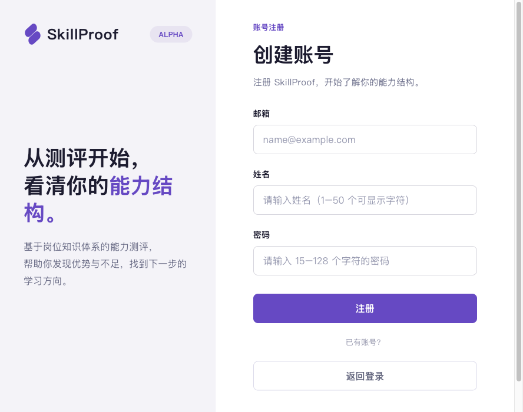

在注册页刷新浏览器后仍留在当前页面，没有跳回登录页。

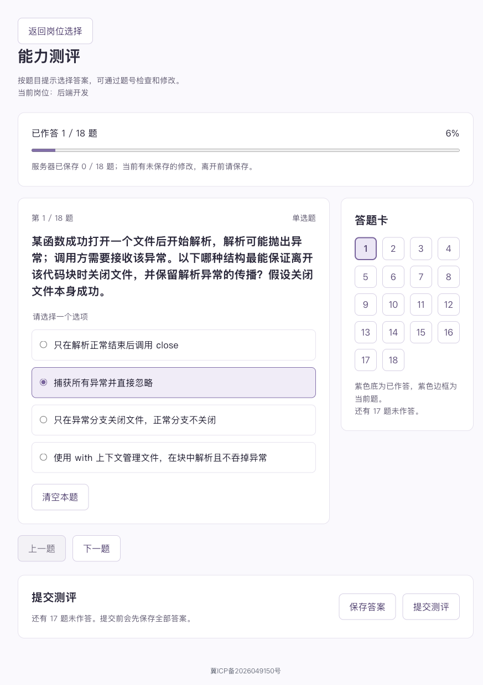

单选题从A改选B后只保留B，作答进度仍是1/18题。

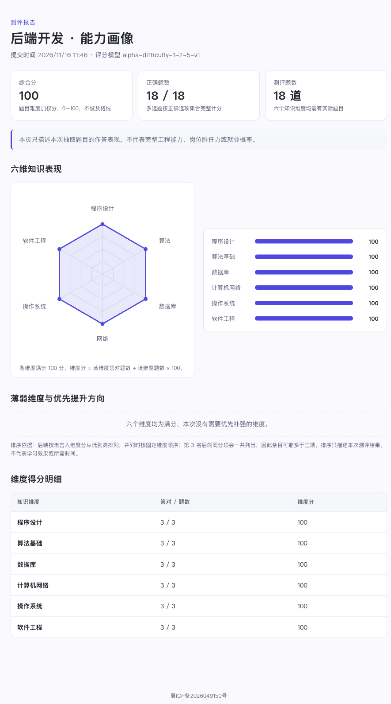

全对提交后显示答对18/18题，综合分和六个维度都是100分，刷新页面后结果不变。

### 场景二：小周在面试前安排优先复习顺序

**用户需求**：小周下周参加后端开发面试，复习时间不多，想知道自己哪块最薄弱、先补什么最划算。测试时先做完6道题保存，试了一下没答完就提交的提示和退出重登后的恢复情况，最后按预设答案答完提交，对照[评分规则](../design/scoring.md)核对分数和薄弱项顺序。

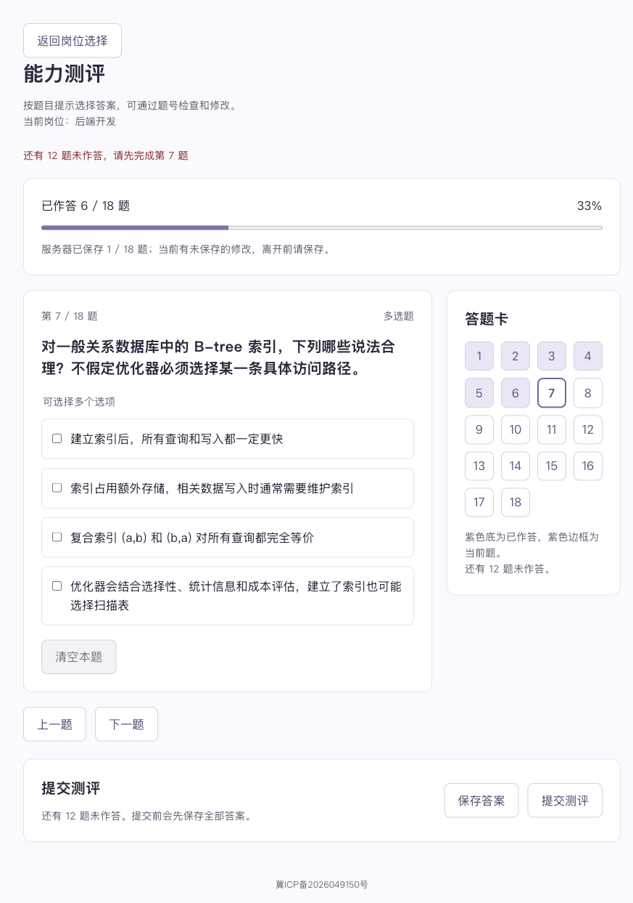

只答6题就点提交时，页面提示还有12道题没做，答题卡自动跳到第7题。这一项是在同一版本上补测的。

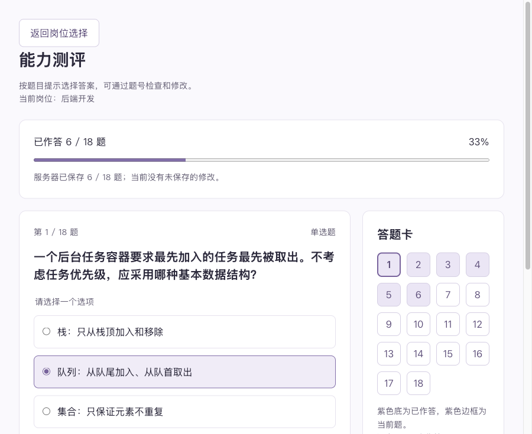

退出后重新登录，打开的还是原来的测评，页面显示已保存6/18题，之前选的答案都在。

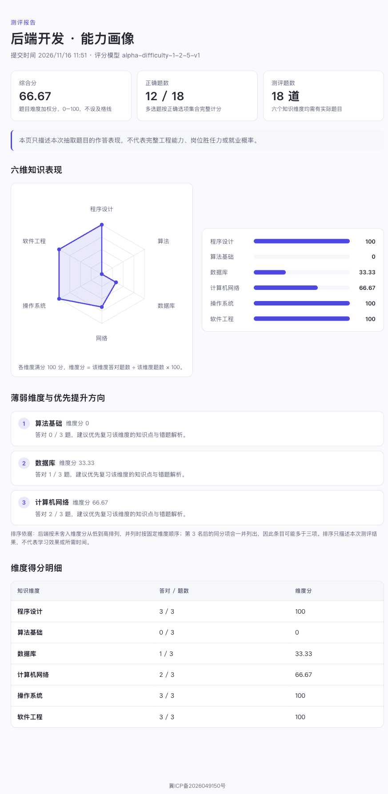

补完提交后答对12/18题，难度加权综合分为66.67分；算法基础0分、数据库33.33分，排在薄弱项前两位，小周可以先集中复习这两块。

## 三、测试矩阵

### 1. Chrome与Firefox对照

Chrome和Firefox在同一台Mac上按相同步骤测试。

| 测试项 | 操作与检查内容 | Chrome | Firefox |
|---|---|---|---|
| 注册登录与选岗 | 注册账号，退出后重新登录，选择后端开发生成18道题 | 通过 | 通过 |
| 保存后刷新 | 答完2道题保存再刷新页面，原来的选项和进度都在 | 通过 | 通过 |
| 未答完提交提示 | 只做2道题就点提交，页面拦截并跳到第3题 | 通过 | 通过 |
| 提交与查看报告 | 答完18题提交后生成六维报告，刷新后分数不变 | 通过 | 通过 |

两边各自独立抽题作答，下面两张图分别是当次提交后的结果页。

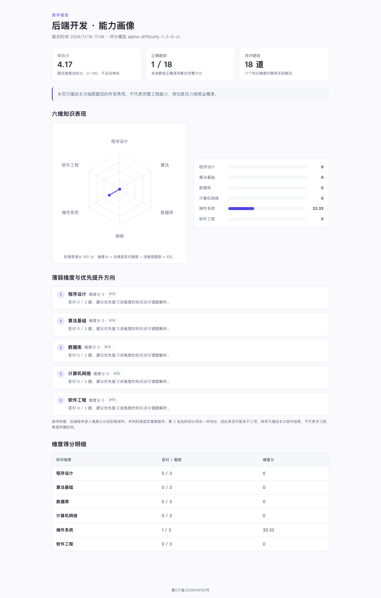

Chrome提交后正常显示六维能力画像和得分明细。

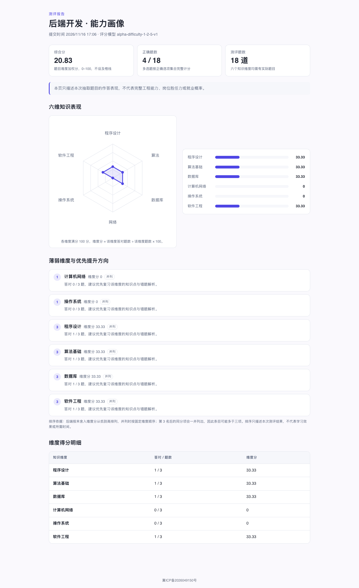

Firefox提交后同样正常显示六维报告，刷新后分数一致。

### 2. 网页操作与访问限制

输错密码时页面提示邮箱或密码不正确，换成正确密码后正常登录。

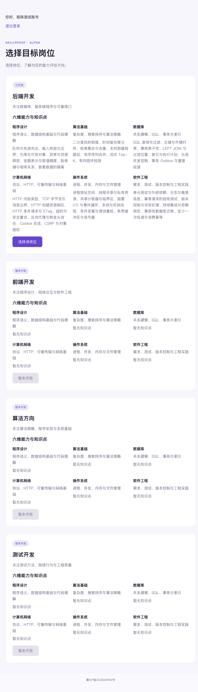

前端开发、算法方向和测试开发目前显示暂未开放，选择按钮不能点击。

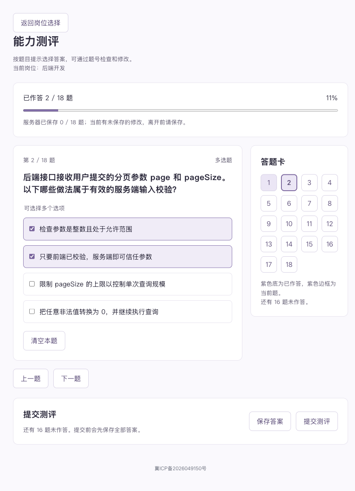

多选题勾选A、B，切到下一题再回来，两个选项都还留着。

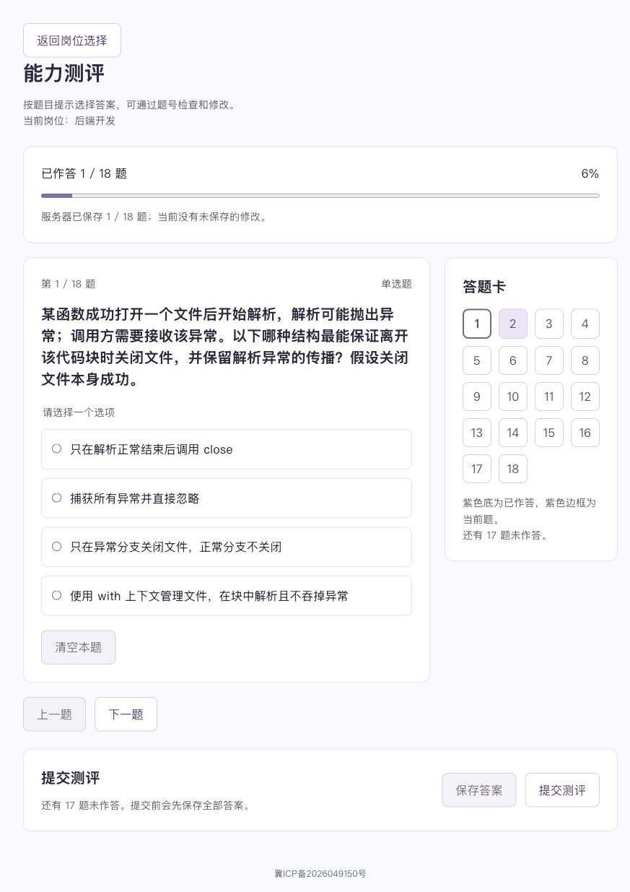

清空第1题保存并刷新后，已作答和已保存题数都从2/18变成1/18。

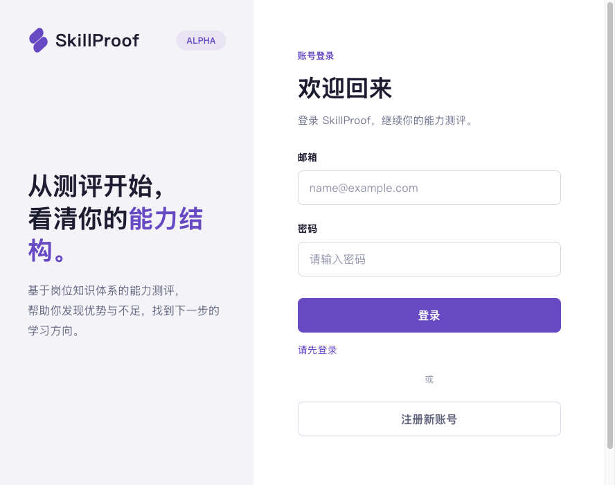

退出登录后再打开自己的报告链接，页面会要求先登录，不会直接显示分数。

### 3. 窄屏布局

另外把Chromium的显示区域分别缩到 390px和 360px，两种宽度下选答案、切题、保存和未答完时的定位都正常；390px下也完成了提交并查看报告。

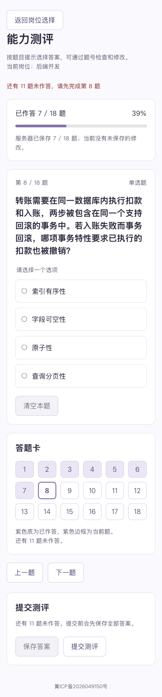

390px宽度下保存7道题后点提交，会自动跳到第8题。

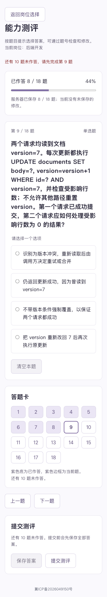

360px宽度下保存8道题后点提交，会自动跳到第9题。

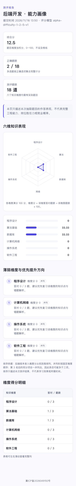

切回 390px答完提交后，六维报告和并列薄弱项都能正常显示。

## 四、Alpha版本出口条件

Alpha阶段我们没有一次铺开所有岗位，前端开发、算法方向和测试开发先留到后续迭代，集中把后端开发岗位的测评做完整。结合实际进度，我们把这版的交付标准定在三件事上：

1. **完成线上部署，打开网页就能测**：[V0.1 版本](https://daybreakme.cn/SkillProof/login)已经部署上线，学生直接用浏览器注册登录，就能用默认题库开始测评。
2. **核心测评流程完整可用**：从注册选岗、抽题作答、中途保存与重新登录恢复，到自动算分、查看六维能力画像和薄弱项顺序，整套流程都能走通，能帮学生摸清基础水平、安排复习顺序。
3. **基本功能稳定，没有卡流程的严重Bug**：之前遇到的默认题库抽不出题、刷新跳页、旧答案覆盖新答案、同分薄弱项漏显示等问题都已经修好；密码错误提示、未开放岗位限制、退出后报告保护，以及Chrome、Firefox和手机窄屏下的页面显示与操作也都正常。

这轮线上测试下来，V0.1 已经达到这些要求，可以作为Alpha版本交付。

## 附：自动化回归与部署验证记录

下表分列线上浏览器测试和部署检查的结果。后端自动化测试的必测清单见 [Issue #12 必测清单](../../tests/acceptance/issues/12.json)，随CI执行通过。

| 检查类别 | 通过 | 失败 | 未执行 |
|---|---:|---:|---:|
| 线上浏览器实测：双浏览器同组对照（4 项 × 2 个浏览器） | 8 | 0 | 0 |
| 线上浏览器实测：学生场景验证（小林 3 项、小周 3 项） | 6 | 0 | 0 |
| 线上浏览器实测：网页操作与访问限制（5 项）、窄屏布局（3 项） | 8 | 0 | 0 |
| 部署验证：后端自动化用例 | 115 | 0 | 0 |
| 部署验证：前端检查（lint、build） | 2 | 0 | 0 |
| 部署验证：浏览器阶段检查（保存、重启后提交、重启后查报告） | 3 | 0 | 0 |

服务重启、安装依赖等部署侧检查由组长在[Alpha部署回归报告](https://github.com/SkillProof-Team/SkillProof/blob/V0.1/docs/testing/alpha-deployment-report.md)中单独记录。本轮没有执行浏览器丢包注入和跨账号越权页面操作，这些异常场景已由后端接口测试覆盖。
